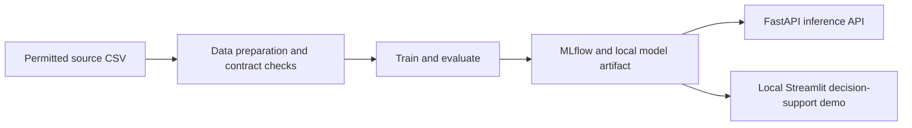

# ProjectChurn_POO 🚀  

## Portfolio overview

A reproducible end-to-end churn prediction case study that connects data contracts, training and evaluation, MLflow tracking, a FastAPI inference API, Docker, automated tests and a local Streamlit decision-support demo.

| Focus | Evidence |
| --- | --- |
| ML/MLOps engineering | Modular pipeline, MLflow, FastAPI, Docker and CI |
| Reproducibility | Documented data contract and verified local benchmark |
| Decision support | Campaign-policy endpoints and a synthetic local demo |
| Scope | Local portfolio project; benchmark values are not production claims |



**Start here:** review the verified benchmark, then run the tests or follow the local demo flow below.

**Customer Churn Prediction API** built with **Python**, **FastAPI**, and **Scikit-Learn**, featuring a reproducible local data contract, an end-to-end inference pipeline, structured logging, MLflow tracking, and Docker configuration.


---

### 🧠 Overview
`ProjectChurn_POO` is a churn prediction reference implementation, redesigned from the original *ProjectChurn* to adopt:
- A **clean OOP architecture** for scalability and maintainability  
- **MLflow integration** for experiment tracking and reproducibility  
- **FastAPI service** exposing a `/predict` endpoint for real-time inference  
- **Dockerized FastAPI service**, validated locally with a health check

This project demonstrates best practices in **MLOps**, **software engineering for ML**, and **data-driven business strategy** for customer retention.

---

### ⚙️ Environment Summary
| Tool | Version |
|------|----------|
| Python | 3.12.10 |
| Pandas | 2.3.3 |
| NumPy | 2.3.4 |
| Scikit-Learn | 1.7.2 |
| XGBoost | 3.4.1 |
| Joblib | 1.5.2 |
| FastAPI | 0.120.4 |
| Uvicorn | 0.38.0 |
| MLflow | 3.5.1 |

---

💡 *Ideal for*:  
Portfolio projects, enterprise churn analysis, or as a reference for OOP-based ML pipeline design.

---

## 🎯 Business Objective
The goal of this project is to **reduce customer churn** in a telecommunications company by identifying clients at high risk of cancellation.  
The predictive model enables the business to proactively engage with customers (via retention campaigns, personalized offers, or improved customer service) before churn occurs.

---

## 🧩 Methodology
1. **Data ingestion and preprocessing** handled by modular classes (`src/data_loader.py`, `src/preprocessing.py`).
2. **Categorical encoding** (Yes/No → 1/0) and **numeric scaling** for model stability.
3. **Random Forest classifier** implemented in a fully OOP structure (`src/models/churn_model.py`).
4. **Evaluation metrics:** accuracy, precision, recall, F1-score, and ROC-AUC (`src/evaluation.py`).
5. **Experiment tracking** with MLflow and **structured logging** for model monitoring.
6. **FastAPI** serves real-time predictions via REST API.
7. **Docker containerization** ensures reproducible and scalable deployment.

---

## 📈 Verified local benchmark

The historical CSV recovered from the original project contains 5,000 rows
(`No=4,293`, `Yes=707`). Its source, schema and SHA-256 fingerprint are
documented in [`docs/DATA_SOURCES.md`](docs/DATA_SOURCES.md).

The current reproducible pipeline uses a stratified 80/20 split with
`random_state=42`, median/mode imputation learned from the training split,
Min-Max scaling for usage features, `log1p` for voicemail messages and a
Random Forest with 100 trees.

| Metric | Verified value |
|---|---:|
| Accuracy | **0.953** |
| Precision | **0.920** |
| Recall | **0.730** |
| F1-score | **0.814** |
| ROC-AUC | **0.904** |

These values are a local benchmark, not a production claim. Earlier numbers
remain historical until each experiment configuration is fully reconstructed.
The decision policy for precision, recall and campaign capacity is documented
in [`docs/MODEL_DECISION.md`](docs/MODEL_DECISION.md).

---

## ⚙️ Project Architecture
```
ProjectChurn_POO/
├── data/ # Raw input data
├── docs/ # Data provenance and decisions
├── scripts/ # Dataset preparation command
├── tests/ # Automated data, pipeline and API tests
├── model/ # Local trained artifacts (.joblib, ignored by Git)
├── logs/ # Structured log files
├── src/
│ ├── data_loader.py
│ ├── data_contract.py
│ ├── training_pipeline.py
│ ├── evaluation.py
│ ├── train.py
│ ├── api/
│ │ └── app.py
│ └── models/
│ ├── base_model.py
│ └── churn_model.py
├── requirements.txt
├── requirements-api.txt # Minimal dependencies for the Docker API image
├── requirements-dev.txt
├── Dockerfile
└── README.md
```


---


---

## 🔧 Tech Stack
- **Python **  
- **Pandas, NumPy, Scikit-learn** — data handling and model training  
- **MLflow** — experiment tracking  
- **FastAPI** — REST API for model inference  
- **Docker** — containerized deployment  
- **Logging & Metrics** — production-grade observability  

---

## 🏃 How to Run

### ▶️ Local execution
```bash
pip install -r requirements-dev.txt
python -m scripts.prepare_data path/to/source.csv
python -m src.train
uvicorn src.api.app:app --reload
```

Before training, read [`data/README.md`](data/README.md) to choose and record a
permitted data source. The preparation step validates the schema and creates a
local canonical dataset; raw data remains outside version control.


### 🐳 Using Docker
```bash
docker build -t projectchurn-api:local .
docker run -d --rm --name projectchurn-api -p 8000:8000 projectchurn-api:local
```

Docker Desktop must be running. The image installs only the API dependencies
from `requirements-api.txt`; experiments and the Streamlit interface remain in
the local development environment. Train locally before the build so that
`model/churn_pipeline.joblib` and the portfolio artifacts exist in the local
build context. They remain ignored by Git.

After starting the container, use `http://127.0.0.1:8000/docs` for interactive
API documentation or `http://127.0.0.1:8000/health` for its status. Stop it
with `docker stop projectchurn-api`.

### Experimento controlado de modelos

O comando abaixo compara famílias de modelos tabulares no mesmo pré-processamento
e faz ajuste limitado de hiperparâmetros somente na família vencedora. A seleção
usa *average precision* na validação cruzada; o limiar operacional maximiza
recall mantendo precisão de pelo menos 90%. O holdout só é usado ao final.

```bash
python -m scripts.run_controlled_experiment
```

Os relatórios e o artefato candidato ficam em
`runs/controlled_tabular_v1/` e são deliberadamente ignorados pelo Git. O
comando não altera `model/churn_pipeline.joblib` nem a API: uma promoção exige
uma decisão explícita após revisar o relatório.

### Auditoria da versão exploratória

Para comparar a preparação `d3` do notebook histórico com uma versão sem
vazamento de dados, execute:

```bash
python -m scripts.run_legacy_d3_comparison
```

O relatório local em `runs/legacy_d3_reconstruction_v1/` não substitui o
artefato da API. A auditoria metodológica está em
[`docs/LEGACY_TO_PRODUCT_AUDIT.md`](docs/LEGACY_TO_PRODUCT_AUDIT.md).

### SVM orientada a cobertura

Para retreinar a SVM com busca voltada a recall e visualizar limiares para
pisos de precisão distintos, execute:

```bash
python -m scripts.run_svm_policy_experiment
```

O resultado em `runs/svm_recall_policy_v1/` é uma prévia por validação cruzada;
o holdout e a API permanecem inalterados.

### Fronteira de políticas de retenção

Para comparar HGB, Random Forest, XGBoost e SVM pelos mesmos pisos de precisão
e capacidades de campanha, execute:

```bash
python -m scripts.run_policy_frontier
```

O relatório local em `runs/policy_frontier_v1/` alimenta a futura escolha de
estratégia na interface; ele não altera a API.

### Planejamento comercial de campanha

A API oferece opções comerciais sem pedir que a pessoa usuária escolha métricas:

- `oferta_premium`: benefício caro ou equipe pequena;
- `contato_humano`: ligação ou atendimento especializado;
- `campanha_padrao`: ação de retenção com custo moderado;
- `comunicacao_ampla`: e-mail, push ou ação escalável de baixo custo.

Primeiro consulte `GET /campaign/objectives`. Em seguida, informe o objetivo e
a quantidade máxima de pessoas que a ação consegue atender:

```json
POST /campaign/plan
{
  "objective": "contato_humano",
  "target_customers": 250
}
```

O endpoint retorna um plano comercial, o alcance sugerido e um aviso quando a
meta ultrapassa a faixa validada. Ele ainda não pontua uma lista de clientes e
não altera o modelo ativo de `/predict`.

Quando a meta for maior que a faixa seletiva, `capacity_handling` permite:

- `manter_perfil_da_oferta`: usar menos contatos e preservar a estratégia;
- `completar_com_campanha_padrao`: preencher a meta com ação de custo moderado;
- `preencher_com_lista_ampla`: preencher a meta com ação escalável e barata.

Por padrão, o plano preserva o perfil da oferta. A interface deve mostrar essas
três escolhas apenas quando a meta ultrapassar a faixa recomendada.

### Pontuação de lote para a demo

Depois de preparar os dados, gere os artefatos locais de demonstração:

```bash
python -m scripts.build_portfolio_demo_models
```

`POST /campaign/score` recebe o plano comercial e uma lista de registros com
`customer_id` (ou `id`) mais as 17 variáveis preditoras. A resposta devolve o
ranking, a indicação de clientes selecionados e nenhuma informação é gravada.
Há um lote sintético em `data/demo/customer_batch_demo.csv`; consulte
[`docs/DEMO_GUIDE.md`](docs/DEMO_GUIDE.md) para o fluxo completo.

### Painel local

Para executar a demonstração visual depois de gerar os artefatos locais:

```bash
streamlit run streamlit_app.py
```

O painel permite escolher uma ação comercial, definir capacidade, usar o lote
sintético ou carregar um CSV e baixar a lista priorizada. Ele é local e não
armazena os lotes enviados.

### Qualidade e automação

```bash
python -m pytest
```

O workflow `.github/workflows/ci.yml` executa os testes e verifica a sintaxe do
painel em Python 3.12 a cada envio para `main` e em pull requests. A imagem
Docker usa Python 3.12 e expõe `GET /health`; antes de testá-la, gere os
artefatos locais de demonstração e inicie o Docker Desktop.
---
## 📋 API Endpoints
| Endpoint   | Method | Description                                                 |
| ---------- | ------ | ----------------------------------------------------------- |
| `/`        | GET    | Health check — confirms the API is running                  |
| `/predict` | POST   | Returns churn probability and class prediction              |
| `/metrics` | GET    | Shows API uptime, total requests, and average response time |

### Example request (/predict)
```
{
  "accountlength": 120,
  "internationalplan": "no",
  "voicemailplan": "yes",
  "numbervmailmessages": 20,
  "totaldayminutes": 250,
  "totaldaycalls": 100,
  "totaldaycharge": 40,
  "totaleveminutes": 180,
  "totalevecalls": 90,
  "totalevecharge": 15,
  "totalnightminutes": 200,
  "totalnightcalls": 80,
  "totalnightcharge": 9,
  "totalintlminutes": 10,
  "totalintlcalls": 3,
  "totalintlcharge": 2.5,
  "numbercustomerservicecalls": 2
}
```
### Example response
```
{
  "churn_probability": 0.42,
  "churn_prediction": 0,
  "interpretation": "No Churn"
}
```
## 🧠 Observability Features

Structured logs persisted under logs/app.log

Automatic error handling with middleware-based exception logging

Internal metrics endpoint (/metrics) for uptime monitoring

Integrated MLflow experiment tracking for reproducibility

## 🚀 Next Steps

Add model retraining pipeline triggered by new data (data drift handling).

Integrate a visualization dashboard (Streamlit / Power BI).

Publish Docker image to Docker Hub.

Deploy the API to a cloud environment (Render, AWS, or Railway).

## 📄 License

MIT License — Free to use for educational, research, and portfolio purposes.

## ✨ Author

**[Bruno Cerqueira](https://www.linkedin.com/in/brunobcerqueira/)**  
🧠 MSc in Astronomy & Astrophysics · Data Scientist · Deep Learning  · TensorFlow 


[](https://github.com/Onirb)
[](https://www.linkedin.com/in/brunobcerqueira/)
